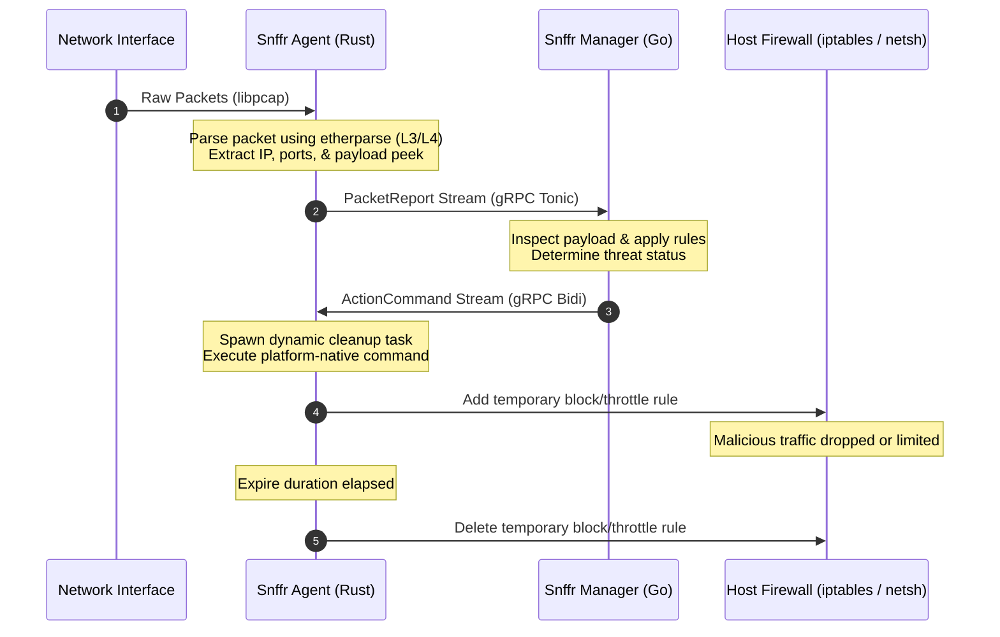

# snffr
### **High-Performance Distributed IDS & Autonomous Response System**

[](https://www.rust-lang.org/)
[](https://go.dev/)
[](https://grpc.io/)
[](https://www.docker.com/)

`snffr` (Sniffer) is a distributed network security system designed to capture network traffic at the edge, analyze it centrally, and execute automated, host-level threat mitigation responses in real-time.

---

## System Architecture

`snffr` utilizes an asynchronous client-server architecture designed for sub-millisecond response loops:



---

## Key Features

- **Distributed Sniffing Agents:** Lightweight edge clients written in **Rust** running synchronously on network interfaces in promiscuous mode with Berkeley Packet Filters (BPF).
- **Centralized Go Manager:** A highly concurrent **Go** manager orchestrating agent reports and managing security logic.
- **Bi-Directional Streaming:** Powered by **gRPC** (`tonic` in Rust, `grpc-go` in Go) with long-lived streaming channels to feed metrics and execute mitigations instantly.
- **Autonomous Countermeasures:** Real-time system calls to add temporal firewall blocks and bandwidth QoS throttling.
- **Cross-Platform Compatibility:**
  - **Linux:** Native `libpcap` capture and `iptables` dynamic drop/rate-limit rules.
  - **Windows:** Native packet capturing, `netsh advfirewall` blocks, and PowerShell QoS traffic throttling.

---

## Detection Models

`snffr` incorporates a hybrid threat detection engine combining deterministic heuristic rule matching with deep learning / statistical inference via ONNX Runtime. The `models/` directory provides four interchangeable ONNX detection models tailored for different deployment environments and performance constraints:

| Model Architecture | Features | Latency (ms/flow) | Throughput (FPS) | Hybrid F1-Score | Hybrid Precision | Primary Focus |
| :--- | :---: | :---: | :---: | :---: | :---: | :--- |
| **`IDSGAN_model`** *(Default)* | 78 | 0.0067 ms | ~148,000 | **75.21%** | **95.55%** | Production inline intrusion detection & automated blocking |
| **`GAN_model`** | 68 | 0.0034 ms | ~293,000 | **69.64%** | **95.23%** | Ultra-high-speed core backbone gateways |
| **`IsolationForest_model`** | 7 | 0.1156 ms | ~8,600 | **2.09%** | **35.98%** | Lightweight edge / IoT baseline anomaly detection |
| **`LightGBM_model`** | 68 | 0.0444 ms | ~22,500 | **0.03%** | **0.64%** | Structured tabular decision-tree IDS |

### 1. IDSGAN (`models/IDSGAN_model/`) — *Default Production Model*
- **Architecture:** Generative Adversarial Network designed for robust intrusion detection under adversarial traffic variations.
- **Input Dimension:** 78 network flow features.
- **In-Graph Preprocessing:** Includes compiled in-graph numerical stabilization (`sign(x) * log1p(|x|)`) and standardization directly within the ONNX computation graph, eliminating external preprocessing latency.
- **Detection Profile:** Highest accuracy and precision on unseen data; achieves a **75.21% F1-score** and **95.55% precision** while blocking 2,500 attacks outright with under a 1.9% false-positive block rate.
- **Recommended For:** Primary inline enterprise traffic inspection and autonomous edge firewall enforcement.

### 2. GAN (`models/GAN_model/`) — *Ultra-High Throughput*
- **Architecture:** Deep neural network / GAN discriminator evaluating network flow statistics.
- **Input Dimension:** 68 network flow features (configured with log1p transformation and standardization parameters via `ids_model_metadata.json`).
- **Detection Profile:** Sub-microsecond inference capability (~0.0034 ms/flow, peaking above 290,000+ flows/sec) with outstanding precision (**95.23% hybrid / 98.11% standalone AI**).
- **Recommended For:** High-throughput 10Gbps/40Gbps edge routing gateways where latency budgets and compute overhead are strictly limited.

### 3. Isolation Forest (`models/IsolationForest_model/`) — *Lightweight Anomaly Detection*
- **Architecture:** Unsupervised tree-based anomaly detector (scikit-learn Isolation Forest exported to ONNX).
- **Input Dimension:** 7 core flow summary features (`Dst Port`, `Flow Duration`, `Tot Fwd Pkts`, `TotLen Fwd Pkts`, `Flow Byts/s`, `Flow Pkts/s`, `Pkt Size Avg`).
- **Detection Profile:** Extremely low resource footprint and minimal feature extraction overhead; exhibits high specificity (96.69% TNR) but is susceptible to concept drift against modern attack distributions without localized retraining.
- **Recommended For:** Resource-constrained IoT edge devices and static network baselines.

### 4. LightGBM (`models/LightGBM_model/`) — *Gradient Boosted Decision Trees*
- **Architecture:** Gradient Boosted Decision Tree (GBDT) ensemble serialized via ONNX.
- **Input Dimension:** 68 tabular network flow features.
- **Detection Profile:** Efficient tree-based inference (~0.044 ms/flow) with compact model storage (~1.98 MB); requires localized calibration and feature alignment to adapt across differing network topology distributions.
- **Recommended For:** Environments utilizing domain-specific retraining pipelines with tabular structured features.

> **Note:** To switch the active model in the Go manager, copy the desired model into `manager/models/ids_model.onnx` (along with any `.data` files). For complete benchmarking methodology, confusion matrices, and cross-dataset evaluations, refer to [results.md](results.md).

---

## Repository Structure

```tree
.
├── agent/                  # Rust Edge Sniffing Agent
│   ├── src/
│   │   ├── main.rs         # Agent Orchestration & gRPC loop
│   │   ├── linux_capture.rs# Linux pcap implementation
│   │   ├── win_capture.rs  # Windows packet capture
│   │   ├── parser.rs       # Layer 3 / 4 packet parsing via etherparse
│   │   └── responder.rs    # Threat mitigation responder
│   └── Dockerfile          # Multi-stage container for Rust agent
├── manager/                # Go Orchestrator & Central Manager
│   ├── internal/           # Manager gRPC server & routing internals
│   ├── models/             # Active ONNX model loaded by manager
│   ├── main.go             # Entrypoint for gRPC listener
│   └── Dockerfile          # Multi-stage container for Go manager
├── models/                 # Pretrained ONNX Detection Models
│   ├── IDSGAN_model/       # Default: 78-feature GAN with in-graph scaling
│   ├── GAN_model/          # 68-feature ultra-fast GAN model
│   ├── IsolationForest_model/# 7-feature anomaly detection baseline
│   └── LightGBM_model/     # 68-feature gradient-boosted decision tree
├── proto/                  # Protobuf contract definitions
│   └── snffr.proto         # PacketReport & ActionCommand schemas
├── tests/                  # Threat testing & simulation utils
│   └── scripts/
│       └── attack_sim.py   # Simulates anomalous UDP/TCP traffic
└── docker-compose.yml      # Complete stack orchestration setup
```

---

## Quick Start

### 1. Run using Docker Compose

Deploy the entire stack with a single command. The agent runs with host networking and kernel capabilities (`NET_ADMIN`, `NET_RAW`) to perform network sniffing and block rules:

```bash
docker-compose up --build
```

### 2. Manual Setup (Running Locally)

#### Prerequisites
- **Rust Compiler** (v1.85+)
- **Go compiler** (v1.26+)
- **Protobuf Compiler** (`protoc`)
- **System Libraries:**
  - Linux: `libpcap-dev`, `iptables`
  - Windows: Npcap / WinPcap driver installed in WinPcap API-compatible mode

#### Step A: Start the Go Manager
```bash
cd manager
go run main.go
```
The manager will boot and listen for agents on port `50051`.

#### Step B: Start the Rust Agent (Requires elevated privileges)
```bash
cd agent
# Linux (Sudo is required for raw sockets and iptables modifications)
sudo cargo run

# Windows (Run command prompt / powershell as Administrator)
cargo run
```

---

## Response Actions Reference

When the manager identifies malicious activity, it streams an `ActionCommand` containing an IP, duration, and limit. The agent dynamically schedules:

| Platform | Action | Command Used | Cleanup Mechanism |
| :--- | :--- | :--- | :--- |
| **Linux** | **BLOCK** | `iptables -A INPUT -s <IP> -j DROP` | Async task runs `iptables -D INPUT ...` |
| **Linux** | **RATE_LIMIT** | `iptables -A INPUT -s <IP> -m limit --limit <PPS>/s -j ACCEPT` | Async task removes accept and drop rules |
| **Windows** | **BLOCK** | `netsh advfirewall firewall add rule ...` | Async task runs `delete rule` |
| **Windows** | **RATE_LIMIT** | `New-NetQosPolicy -ThrottleRateActionBitsPerSecond ...` | Async task runs `Remove-NetQosPolicy` |

---

## Roadmap
- [ ] **Dynamic Attack Graphing:** Visualize attack vectors in dashboard view.
